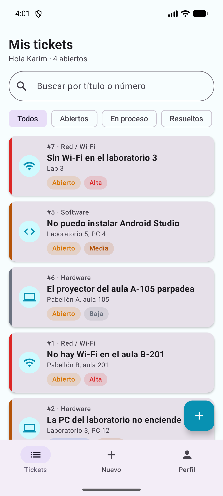
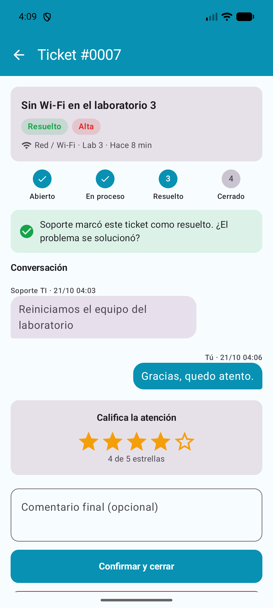
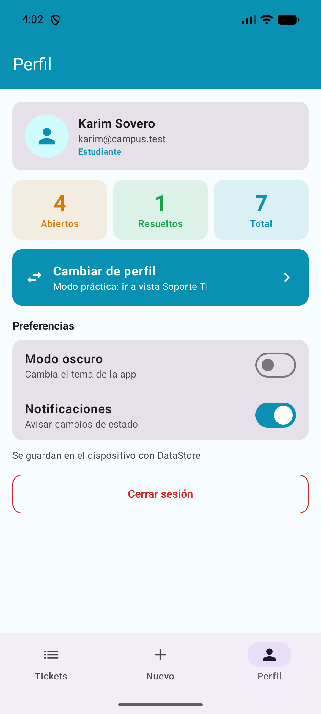
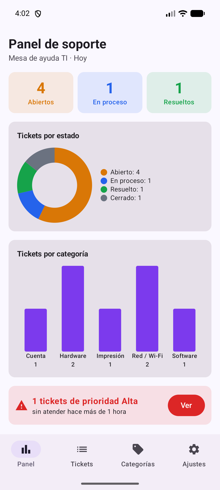
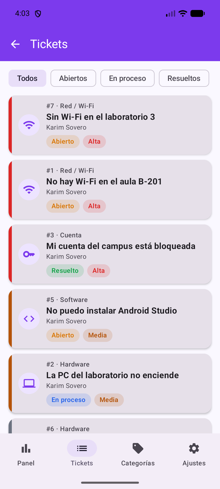
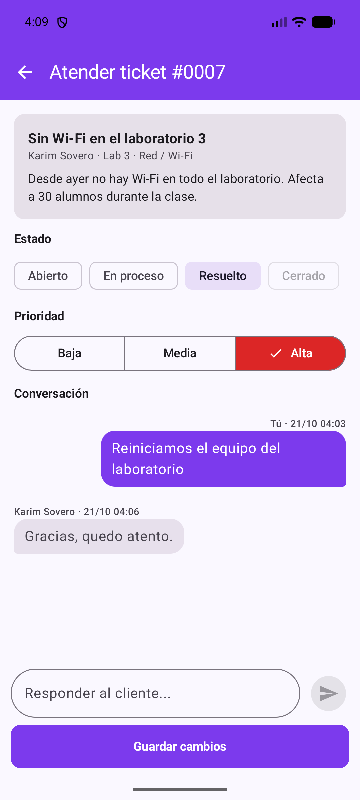

# AyudaCampus

Karim Sovero · Programación en Móviles · Tecsup · Laboratorio 08 (MVVM + Room)

## Descripción

AyudaCampus es la mesa de ayuda de TI de un campus, con dos perfiles en el mismo dispositivo:

- **Estudiante:** reporta una incidencia (Wi-Fi, equipo, cuenta, impresión), conversa con Soporte y califica la atención al cerrar el ticket.
- **Soporte TI:** ve el panel con contadores y gráficos, atiende los tickets ordenados por prioridad (cambia estado y prioridad, responde) y administra las categorías.

Ambos perfiles comparten la misma base de datos Room: cuando Soporte responde o cambia el estado de un ticket, el estudiante lo ve al instante en su detalle.

**Tecnología:** Kotlin, Jetpack Compose, Material 3 (sin XML), Room, DataStore, Navigation Compose. Patrón MVVM + Repository (interface).

## Árbol de paquetes

```
com.sovero.ayudacampus
├── MainActivity.kt
├── AyudaApp.kt
├── data
│   ├── local
│   │   ├── entity        Categoria, Usuario, Ticket, Comentario
│   │   ├── dao           CategoriaDao, UsuarioDao, TicketDao
│   │   ├── relation      TicketConDetalle
│   │   ├── AyudaDatabase.kt
│   │   └── DatosIniciales.kt
│   ├── repository        AyudaRepository (interface), AyudaRepositoryRoom
│   └── prefs             PreferenciasStore (DataStore)
├── model                 Rol, EstadoTicket, Prioridad, ConteoCategoria
├── viewmodel             AyudaViewModelFactory, CategoriasViewModel, SesionViewModel,
│                         MisTicketsViewModel, NuevoTicketViewModel, TicketDetalleViewModel,
│                         PanelViewModel, BandejaViewModel, AtenderViewModel
└── ui
    ├── theme             Color, Type, Theme
    ├── components        AppTopBar, AyudaButton, AyudaTextField, EstadoChip, PrioridadChip,
    │   │                 TicketCard, BurbujaComentario, StepperTicket, Estrellas
    │   └── graficos      GraficoDona, GraficoBarras
    ├── navigation        Rutas, NavAyuda
    ├── cliente           SplashScreen, LoginScreen, MisTicketsScreen, NuevoTicketScreen,
    │                     DetalleTicketScreen, PerfilScreen
    └── soporte           PanelScreen, BandejaScreen, AtenderTicketScreen, CategoriasScreen,
                          FormularioCategoriaScreen, AjustesScreen
```

## Diagrama MVVM

```
VIEW (Composable)
   │ eventos (clics)            ▲ collectAsState()
   ▼                            │
VIEWMODEL (StateFlow + reglas de negocio)
   │ llama                      ▲ Flow / resultados
   ▼                            │
AyudaRepository (interface)
   │ la implementa
   ▼
AyudaRepositoryRoom ──► DAO ──► SQLite (ayudacampus.db)

DataStore (solo preferencias) ──► ViewModel
```

- La **View** solo conoce a su ViewModel.
- El **ViewModel** solo conoce la interface `AyudaRepository`.
- El **Repository** usa los DAOs; el **DAO** solo tiene SQL y entidades.

## Capturas

### Estudiante

| Mis tickets | Detalle y calificación | Perfil |
|---|---|---|
|  |  |  |

### Soporte TI

| Panel | Bandeja de tickets | Atender ticket |
|---|---|---|
|  |  |  |

## Pruebas de aceptación

| Prueba | Resultado esperado | OK |
|---|---|---|
| Login con clave incorrecta | Mensaje de error, no entra | ✅ |
| Estudiante: crear ticket vacío | Errores junto a cada campo, no se crea | ✅ |
| Estudiante: crear ticket válido | Aparece en Mis tickets como ABIERTO con prioridad elegida | ✅ |
| Soporte: bandeja | El ticket nuevo aparece; los de prioridad Alta salen primero | ✅ |
| Soporte: pasar a En proceso y responder | El estudiante ve el nuevo estado y la respuesta sin reiniciar | ✅ |
| Soporte: intentar cerrar un ticket | La opción Cerrado está deshabilitada | ✅ |
| Soporte: marcar Resuelto | El estudiante ve el aviso verde, califica con 4 estrellas y cierra | ✅ |
| Estudiante: reabrir un ticket resuelto | Vuelve a Abierto y se borra la calificación | ✅ |
| Comentar en un ticket cerrado | El campo no aparece | ✅ |
| Panel | Contadores y gráficos coinciden con la bandeja; la alerta cuenta las ALTA abiertas con más de 1 hora | ✅ |
| Desactivar una categoría | Ya no se puede elegir al crear un ticket | ✅ |
| Cerrar y abrir la app | Los tickets siguen ahí y el perfil y el modo oscuro se recuerdan | ✅ |

## Para pensar

| Pregunta | Respuesta |
|---|---|
| ¿Por qué las reglas de estado están en el ViewModel y no en el DAO ni en el Composable? | Son reglas de negocio: el DAO solo guarda datos y el Composable solo muestra, así la regla vive en un solo lugar y no depende de la pantalla. |
| ¿Por qué crearTicket es suspend y observarTicket es Flow? | crearTicket se ejecuta una sola vez y devuelve el id; observarTicket debe avisar cada vez que el ticket cambia para que la pantalla se actualice sola. |
| ¿Qué pasaría si un ticket pudiera cerrarse sin calificación? | No se podría medir la atención y el estudiante cerraría sin confirmar que el problema se solucionó. |
| ¿Qué debería cambiar si mañana los tickets viven en un servidor? | Solo una nueva implementación de AyudaRepository (por ejemplo con Retrofit); los ViewModels y las pantallas siguen igual porque solo conocen la interface. |
