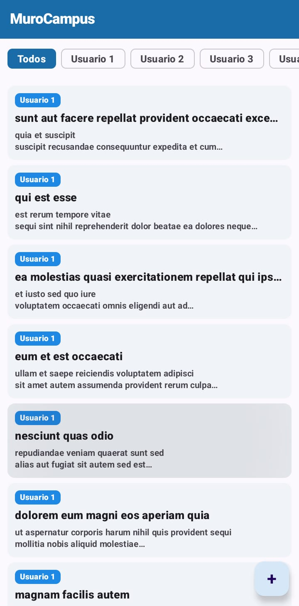
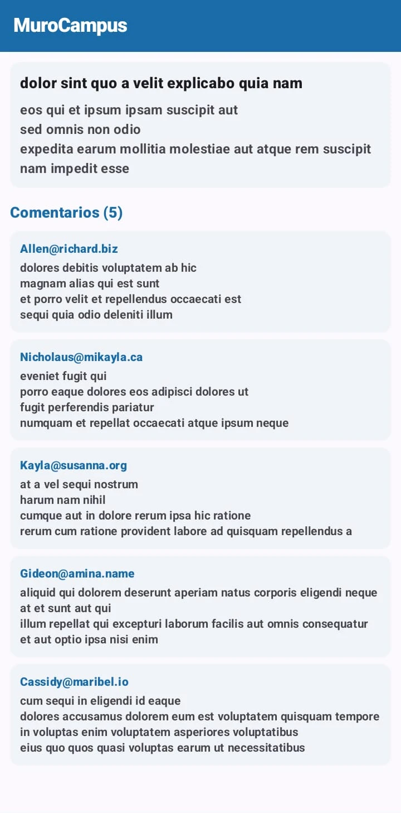
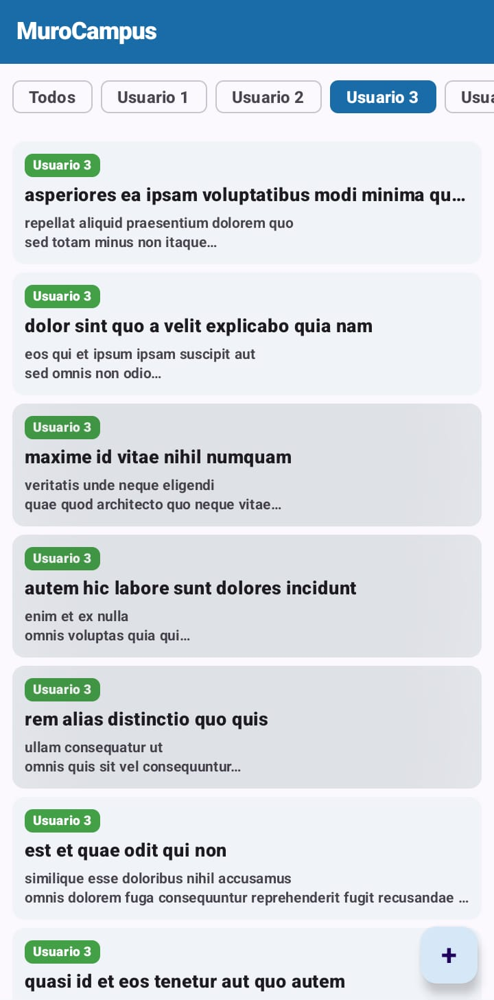
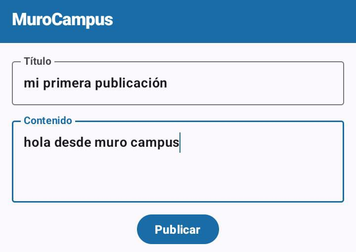
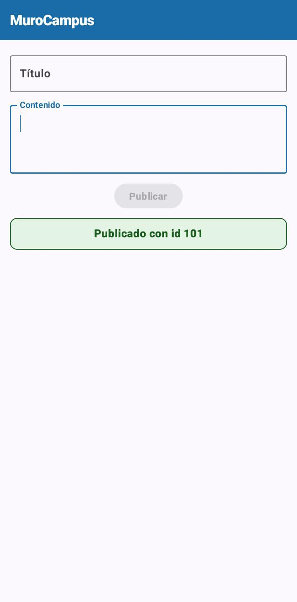
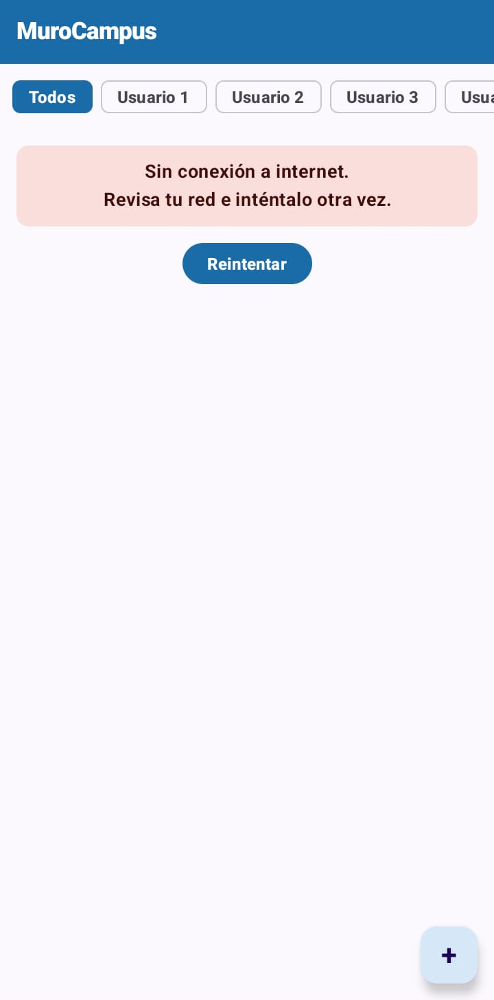

# MuroCampus

App de Android que consume un servicio web REST
([JSONPlaceholder](https://jsonplaceholder.typicode.com/)): lista publicaciones,
muestra el detalle con sus comentarios, filtra por usuario y crea una publicación
nueva. Si no hay internet, muestra un mensaje claro con el botón **Reintentar** y la
app no se cierra.

| Dato | Valor |
|---|---|
| Curso | Programación en Móviles · Laboratorio 09 (Servicios web y plataforma REST) |
| Alumno | Karim Sovero |
| Paquete | `com.sovero.murocampus` |
| Tecnologías | Kotlin, Jetpack Compose + Material 3, Retrofit, OkHttp, kotlinx.serialization |
| Patrón | MVVM + Repository (interface) |

## Qué hace

- **Lista:** las 100 publicaciones con la etiqueta «Usuario N», el título y dos líneas
  del texto. Mientras carga, muestra «Cargando publicaciones…».
- **Detalle (`@Path`):** al tocar una publicación, su texto completo y
  «Comentarios (5)» con el correo y el texto de cada uno. Atrás vuelve a la lista sin
  recargarla.
- **Filtro (`@Query`):** chips Todos y Usuario 1 a Usuario 10; pide `posts?userId=N`.
- **Crear (`@POST` + `@Body`):** el botón **+** abre el formulario; **Publicar** está
  deshabilitado si falta el título o el contenido. Responde «Publicado con id 101».
- **Errores:** sin internet, error del servidor o JSON inesperado se muestran como un
  mensaje con **Reintentar**.

## Capturas

| Lista | Detalle | Filtro |
|---|---|---|
|  |  |  |

| Crear: formulario | Crear: publicado | Error de conexión |
|---|---|---|
|  |  |  |

## Fase 2 · Mejoras con IA (rama MEJORA-IA)

| Mejora | Qué hace | Capas |
|---|---|---|
| Encabezado con interceptor | Un `Interceptor` de OkHttp agrega `Accept: application/json` a todas las peticiones. | RetrofitClient |
| Búsqueda | Campo «Buscar por título» que filtra las publicaciones ya descargadas. | ViewModel + View |
| Paginación simple | Carga de 20 en 20 con `@Query("_start")` y `@Query("_limit")` y el botón **Cargar más**. | API + Repository + ViewModel + View |
| Borrar publicación | Botón **Eliminar** en el detalle con `@DELETE("posts/{id}")`; revisa el código con `Response<Unit>` y muestra «Publicación eliminada (código 200)». | API + Repository + ViewModel + View |
| Editar con PATCH | Pantalla **Editar título** con `@PATCH("posts/{id}")` que muestra la respuesta del servidor. | API + Repository + ViewModel + View |
| Caché en Room | Guarda las publicaciones en Room; sin internet muestra las guardadas con el aviso «Sin internet: mostrando publicaciones guardadas». El Repository decide si usa la red o la base de datos. | Repository + Room |

Los prompts usados y qué cambié de cada respuesta están en [PROMPTS.md](PROMPTS.md).

## Estructura de paquetes

```text
com.sovero.murocampus/
├── MainActivity.kt                 crea el ViewModel y cambia entre lista, detalle y crear
├── model/
│   └── Modelos.kt                  Post, Comentario, NuevoPost (+ Usuario del ejemplo)
├── data/
│   ├── local/                      (Fase 2) PostEntity, PostDao y MuroDatabase de Room
│   ├── remote/
│   │   ├── PostApi.kt              interface de Retrofit (+ UsuarioApi)
│   │   └── RetrofitClient.kt       Retrofit + OkHttp + conversor JSON
│   ├── PostRepository.kt           interface + PostRepositoryRemote (devuelve Result)
│   └── UsuarioRepository.kt        ejemplo resuelto de la guía
├── viewmodel/
│   ├── UiState.kt                  Cargando, Exito, Error y mensajeDe()
│   ├── PostsViewModel.kt           lista, filtro, detalle y crear
│   └── PostsViewModelFactory.kt
└── ui/
    ├── Componentes.kt              TarjetaPost, Cargando, ErrorConReintento
    ├── PantallaLista.kt
    ├── PantallaDetalle.kt
    ├── PantallaCrear.kt
    ├── PantallaEditar.kt           (Fase 2) editar el título con PATCH
    └── theme/
```

## Arquitectura MVVM

```text
View (PantallaLista, PantallaDetalle, PantallaCrear)
   |  eventos: cargar, filtrar, abrir, publicar     ^  collectAsStateWithLifecycle()
   v                                                |
ViewModel (PostsViewModel) --- StateFlow<UiState> (Cargando / Exito / Error) --->
   |  viewModelScope.launch
   v
PostRepository (interface)  <- devuelve Result<...>
   -> PostRepositoryRemote (captura IOException, HttpException...)
   |
   v
PostApi (Retrofit) --- OkHttp ---> https://jsonplaceholder.typicode.com/
```

- La **View** solo dibuja el estado con un `when` y avisa los toques.
- El **ViewModel** solo conoce la interface `PostRepository`: no tiene Retrofit,
  `PostApi`, `HttpException` ni `Context`.
- El **Repository** nunca deja escapar una excepción: la convierte en
  `Result.failure`.

## Cómo ejecutarlo

1. Abrir la carpeta `Semana09` en Android Studio y hacer **Sync**.
2. Ejecutar en un celular o emulador **con internet**.
3. Para ver el tráfico, abrir **Logcat** con el filtro `okhttp`.

## Para pensar

**1. ¿Qué diferencia hay entre GET y POST? ¿Por qué crear lleva `@Body` y porUsuario lleva `@Query`?**
GET **lee** datos y no cambia nada en el servidor; POST **envía** datos para crear algo
nuevo. Crear manda una publicación entera (título, texto y usuario), por eso va como
JSON en el cuerpo con `@Body`. porUsuario solo necesita un dato para filtrar, y eso va
al final de la URL: `posts?userId=2`, que es lo que hace `@Query`.

**2. ¿Por qué la ruta es `"posts"` y no `"/posts"`?**
Porque Retrofit une la ruta con la URL base. Si la ruta empieza con `/`, Retrofit la
toma como ruta absoluta y reemplaza el camino de la URL base. Sin la barra, la ruta se
agrega al final de `https://jsonplaceholder.typicode.com/`, que termina en `/`.

**3. ¿Por qué el Repository devuelve `Result` en vez de dejar que la excepción llegue al ViewModel?**
Así ninguna falla de red cierra la app: el error llega como un dato
(`Result.failure`) y el ViewModel lo convierte en `UiState.Error`. Además, el ViewModel
no necesita conocer `IOException` ni `HttpException`, que son de la red; solo sabe si
salió bien o mal.

**4. ¿Qué pasa si olvidas el permiso INTERNET? ¿Y si olvidas `ignoreUnknownKeys` y el servidor agrega un campo nuevo?**
Sin el permiso, la app compila pero nunca se conecta: siempre sale el error de red
aunque haya internet. Sin `ignoreUnknownKeys`, cuando el JSON trae un campo que el
modelo no tiene, la conversión falla con `SerializationException` y sale «Respuesta
inesperada».

**5. ¿Por qué la pantalla de lista usa un `when` sobre `UiState` y no un `if` con tres variables?**
Porque con `UiState` la pantalla está siempre en **un solo** estado: cargando, éxito o
error. Con tres variables (`cargando`, `datos`, `error`) podrían quedar dos activas a la
vez, por ejemplo cargando y con error. Además, como `UiState` es `sealed`, el `when`
obliga a dibujar los tres casos y no se olvida ninguno.

**6. JSONPlaceholder no guarda los POST. ¿Cómo cambiaría tu app si usaras un servicio real?**
La publicación nueva sí quedaría guardada: después de publicar habría que volver a
cargar la lista (o agregar el post recibido al inicio) para que aparezca. También
habría que manejar más respuestas del servidor, como datos inválidos o falta de
permisos, y normalmente enviar un token de usuario en cada petición.
