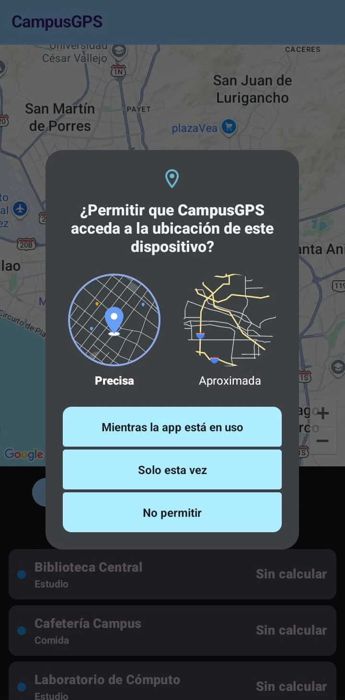
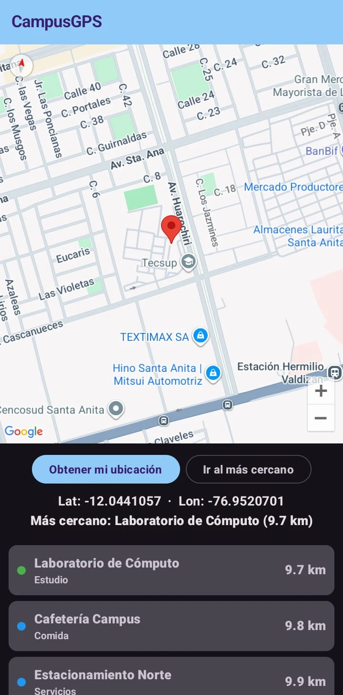
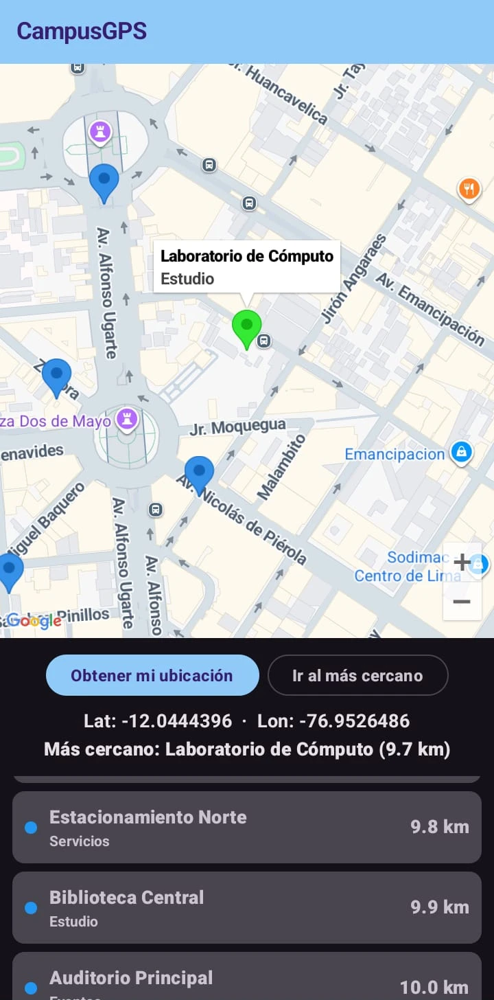
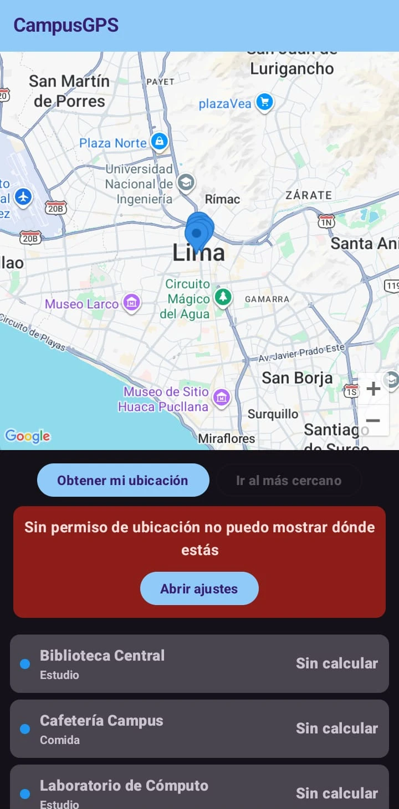
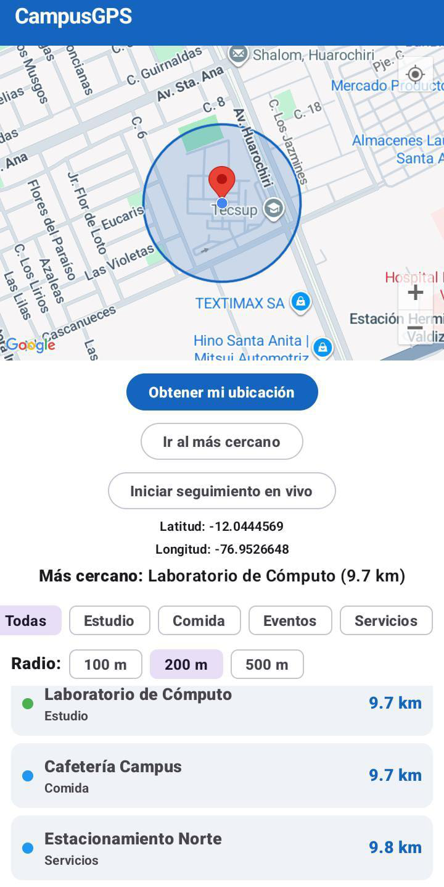
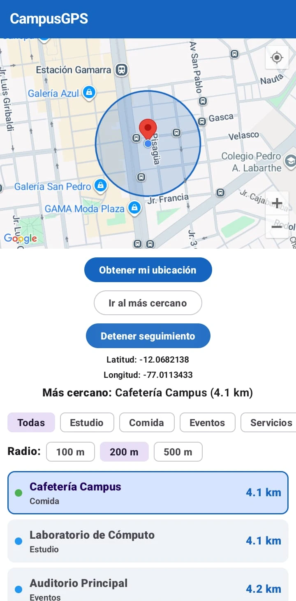

# CampusGPS

App Android que obtiene la ubicación del celular, la muestra en un mapa de Google
y dice qué lugar del campus está más cerca. Muestra cinco lugares ficticios
(biblioteca, cafetería, laboratorio, auditorio y estacionamiento) con su
distancia, ordenados del más cercano al más lejano.

| Dato | Valor |
|---|---|
| Curso | Programación en Móviles · Laboratorio 13 (Localización geográfica) |
| Alumno | Karim Sovero |
| Paquete | `com.sovero.campusgps` |
| Tecnologías | Kotlin, Jetpack Compose + Material 3, Google Play Services Location, Maps Compose |
| Patrón | MVVM + Repository (interface) |

## Qué hace

- Pide el permiso de ubicación al pulsar **Obtener mi ubicación**.
- Muestra un mapa de Google con el marcador rojo **Estás aquí**.
- Dibuja los 5 lugares del campus en azul; el más cercano sale en verde.
- Calcula la distancia a cada lugar y los ordena (en `m` o `km`).
- Al tocar un lugar de la lista, el mapa viaja hasta él.
- El botón **Ir al más cercano** lleva la cámara al lugar verde.
- Si algo sale mal, muestra un mensaje claro y una acción:
  - permiso negado → **Abrir ajustes**
  - GPS apagado → **Reintentar**
  - sin Google Play Services → solo el mensaje

## Capturas

| Permiso | Mapa con mi ubicación | Marcadores |
|---|---|---|
|  |  |  |

| Lista ordenada | Error |
|---|---|
|  |  |

## Fase 2 · Mejoras con IA (rama MEJORA-IA)

| Mejora | Qué hace | Capas |
|---|---|---|
| Diseño igual a la guía | Tema siempre claro, botones uno debajo del otro, distancia en azul y error sin mapa. | View |
| Filtrar por categoría | Chips Todas, Estudio, Comida, Eventos y Servicios; el ViewModel filtra con `combine` y el mapa y la lista muestran solo esos lugares. | ViewModel + View |
| Radio de cercanía | Chips de 100, 200 y 500 m; un `Circle` alrededor de tu posición y la etiqueta «Dentro del radio» en la lista. | ViewModel + View |
| Punto azul nativo | `isMyLocationEnabled` y el botón de mi ubicación del mapa, solo si el permiso fue concedido. | View |
| Seguimiento en vivo | `requestLocationUpdates` convertido en un `Flow` con `callbackFlow`; botones Iniciar / Detener seguimiento. | Repository + ViewModel + View |

| Lista y selección | Radio y círculo | Seguimiento en vivo |
|---|---|---|
|  |  |  |

- **Lista y selección:** al tocar «Cafetería Campus» la tarjeta queda resaltada y el
  mapa muestra su nombre. Arriba se ven los chips de categoría y de radio.
- **Radio y círculo:** con 200 m elegido se dibuja el círculo azul alrededor de mi
  posición.
- **Seguimiento en vivo:** el botón cambia a «Detener seguimiento» y el mapa sigue mi
  posición con el punto azul.

Los prompts usados y qué cambié de cada respuesta están en [PROMPTS.md](PROMPTS.md).

## Estructura de paquetes

```text
com.sovero.campusgps/
├── MainActivity.kt
├── model/
│   └── Modelos.kt                    Posicion, Lugar, LugarConDistancia, UbicacionUi, TipoError
├── data/
│   ├── UbicacionRepository.kt        interface (+ playServicesDisponible, seguirPosicion)
│   ├── UbicacionRepositoryGoogle.kt  implementación con FusedLocationProviderClient
│   ├── LugaresRepository.kt          interface
│   └── LugaresRepositoryLocal.kt     los 5 lugares ficticios
├── util/
│   ├── Distancia.kt                  distanciaMetros (Location.distanceBetween)
│   └── Formato.kt                    formatearDistancia (m / km)
├── viewmodel/
│   ├── MapaViewModel.kt              estado, lugares, seleccionado, masCercano
│   └── CampusViewModelFactory.kt     crea el ViewModel con sus repositorios
└── ui/
    ├── PantallaMapa.kt               pantalla principal y permiso
    ├── MapaUbicacion.kt              GoogleMap, cámara y marcadores
    ├── ListaLugares.kt               lista de lugares con distancia
    ├── MensajeError.kt               recuadro de error con su botón
    └── theme/
```

## Arquitectura MVVM

```text
View (PantallaMapa, MapaUbicacion, ListaLugares, MensajeError)
   |  evento: pulsar un botón o tocar un lugar     ^  collectAsState()
   v                                               |
ViewModel (MapaViewModel)  ------ StateFlow ------>
   |  llama solo a las interfaces
   v
UbicacionRepository  ---> UbicacionRepositoryGoogle (FusedLocationProviderClient)
LugaresRepository    ---> LugaresRepositoryLocal (los 5 lugares)

util/ (Distancia, Formato): funciones puras que usa el ViewModel
```

- La **View** solo dibuja el estado y avisa al ViewModel; no calcula distancias.
- El **ViewModel** solo conoce las interfaces y no recibe `Context`.
- El **Repository** es el único que habla con Google Play Services.

## Cómo ejecutarlo

1. Abrir la carpeta `Semana13` en Android Studio.
2. Crear una clave de **Maps SDK for Android** en Google Cloud y restringirla al
   paquete `com.sovero.campusgps` y a la huella SHA-1 de tu PC
   (`./gradlew signingReport`).
3. En `local.properties` agregar la línea:

   ```properties
   MAPS_API_KEY=tu_clave
   ```

   Ese archivo está en `.gitignore`: la clave **no** se sube al repositorio.
4. Sync y Run en un emulador **con Google Play** o en un celular.
5. En el emulador, poner la ubicación en el punto base:
   **⋮ → Location → -12.0464, -77.0428 → Set location**.

## Para pensar

**1. ¿Por qué `FusedLocationProviderClient` está dentro del Repository y no en el ViewModel?**
Porque el ViewModel no debe depender de Android ni de Google Play Services. El
ViewModel solo pide "dame mi posición" a la interface `UbicacionRepository`; cómo
se consigue la ubicación es trabajo de `UbicacionRepositoryGoogle`. Así el
ViewModel no necesita un `Context` y, si mañana cambiamos la forma de obtener la
ubicación, solo se toca el Repository.

**2. ¿Qué diferencia hay entre el permiso de ubicación y la clave de API de Maps? ¿Qué pasa si falta cada uno?**
El permiso lo da el **usuario** y sirve para saber dónde está el celular. La clave
la da **Google Cloud** y sirve para dibujar el mapa. Si falta el permiso, el mapa se
ve pero la app no sabe dónde estás y muestra el mensaje con **Abrir ajustes**. Si
falta la clave (o está mal restringida), la ubicación funciona pero el mapa sale
gris.

**3. ¿Por qué la clave va en `local.properties` y no en el código? ¿Qué harías si se subiera a GitHub por error?**
Porque `local.properties` no se sube al repositorio, así la clave no queda pública.
Gradle la lee y la pone en el Manifest con `manifestPlaceholders`. Si se subiera
por error, la borraría en Google Cloud y crearía una nueva, porque la anterior ya
no es segura aunque se borre del repositorio.

**4. ¿Dónde calculas la distancia y por qué no en el Composable?**
En el ViewModel, en `actualizarDistancias()`, usando `distanciaMetros()` de
`util/Distancia.kt`. No va en el Composable porque la pantalla solo debe dibujar;
si calculara, se repetiría cada vez que se redibuja y se rompería MVVM.

**5. ¿Qué pasa con tu app si el usuario niega el permiso dos veces? ¿Cómo lo manejas?**
Android ya no vuelve a mostrar el cuadro del permiso. La app no se cierra: muestra
"Sin permiso de ubicación no puedo mostrar dónde estás" con el botón **Abrir
ajustes**, que lleva a la pantalla de la app en Ajustes para activar el permiso a
mano.
