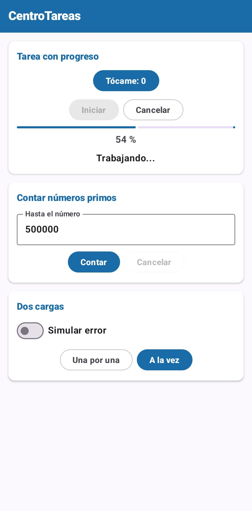
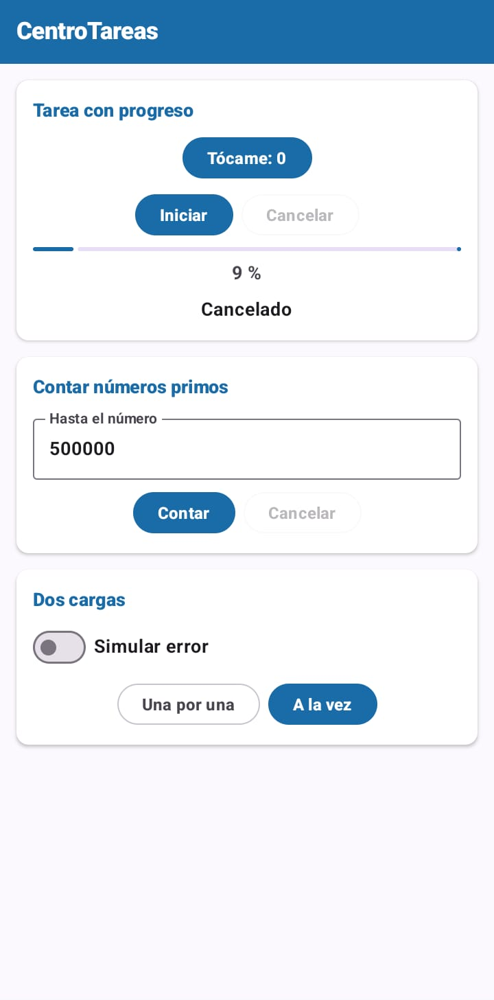
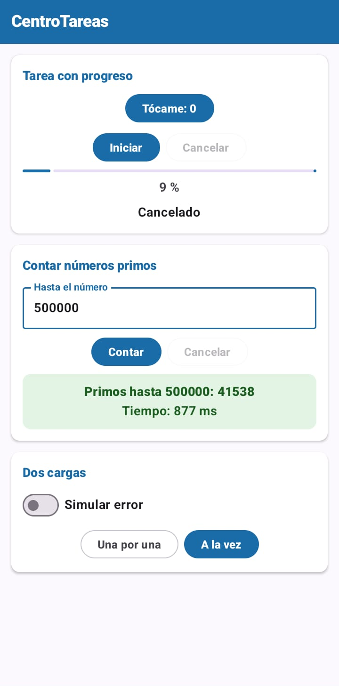
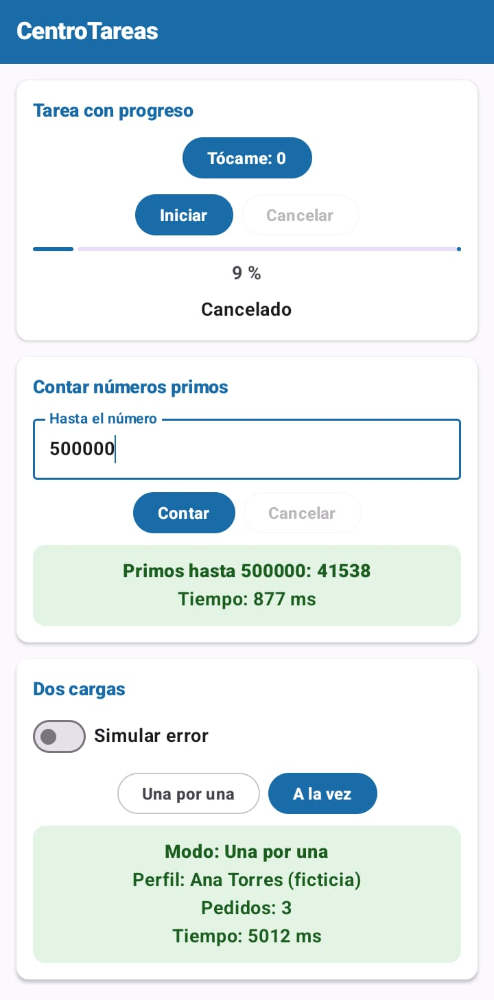
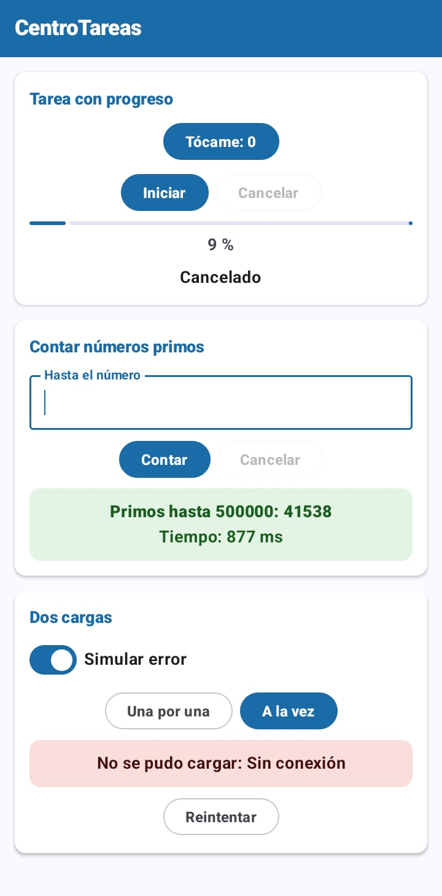
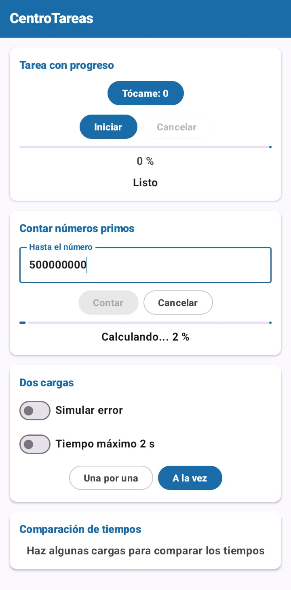
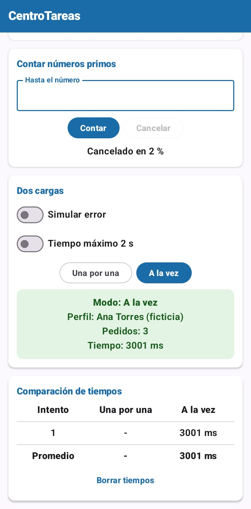

# CentroTareas

App de Android (Kotlin + Jetpack Compose + Material 3) que hace tres tareas que tardan
sin congelar la pantalla: una tarea con progreso, contar números primos y dos cargas
de datos simuladas. Laboratorio 14 · Hilos en Android.

- **Alumno:** Karim Sovero
- **Patrón:** MVVM + Repository (interface)
- **Corrutinas:** `viewModelScope.launch`, `withContext`, `Job`, `async` / `await`
- Sin permisos ni internet: las cargas se simulan con `delay` y los datos son ficticios.

## Árbol de paquetes

```
com.sovero.centrotareas/
├── MainActivity.kt
├── model/
│   └── Estados.kt                  PrimosUi, CargaUi
├── data/
│   ├── TareasRepository.kt         interface
│   └── TareasRepositoryLocal.kt    cargas simuladas y contarPrimos
├── viewmodel/
│   ├── TareasViewModel.kt          tarea con progreso, primos y cargas
│   └── TareasViewModelFactory.kt
└── ui/
    ├── PantallaTareas.kt           las tres tarjetas
    └── theme/
```

## Arquitectura MVVM

```
View (PantallaTareas)
   |  eventos: botones              ^  collectAsState()
   v                                |
ViewModel (TareasViewModel)  --- StateFlow --->
   |  viewModelScope.launch { ... }
   v
TareasRepository (interface)  --->  TareasRepositoryLocal
                                    (cargas simuladas y contar primos)
```

- La **pantalla** solo muestra el estado y avisa los toques; no lanza corrutinas.
- El **ViewModel** lanza las corrutinas con `viewModelScope` y expone `StateFlow`.
- El **Repository** hace el trabajo: cuenta primos en `Dispatchers.Default` y simula
  las cargas con `delay`.

## Observación del Paso 1

**Qué pasa con la pantalla:** al tocar **Tarea larga (MAL)** la app se queda quieta
durante 4 segundos. Si toco **Tócame** en ese tiempo, el contador no sube y el botón no
reacciona. Cuando pasan los 4 segundos, el texto cambia directo a **Terminó** y recién
ahí se ven los toques que hice.

**Por qué no se ve «Trabajando...»:** `Thread.sleep(4000)` se ejecuta en el hilo
principal, que es el mismo que dibuja la pantalla. El mensaje sí cambia a
«Trabajando...», pero el hilo está dormido y no puede volver a dibujar. Cuando despierta,
el mensaje ya es «Terminó», así que solo se dibuja ese.

**Si la espera fuera de 10 segundos:** Android mostraría el aviso **«La aplicación no
responde» (ANR)**, con la opción de cerrarla o esperar. Esto pasa cuando el hilo
principal no atiende un toque durante unos 5 segundos.

## Capturas

| Tarea con progreso | Tarea cancelada | Primos |
|---|---|---|
|  |  |  |

| Una por una | Error y Reintentar |
|---|---|
|  |  |

1. **Tarea con progreso:** la barra va en 54 %, dice «Trabajando...», Iniciar está
   deshabilitado y Cancelar habilitado.
2. **Tarea cancelada:** la barra se quedó en 9 %, dice «Cancelado» y se puede volver a
   pulsar Iniciar.
3. **Primos:** hasta 500 000 hay 41 538 primos, igual que la tabla de la guía.
4. **Una por una:** perfil y pedidos en 5012 ms (2 s + 3 s). **A la vez** tarda lo que
   la carga más lenta, unos 3 s.
5. **Error:** con «Simular error» activado sale «No se pudo cargar: Sin conexión» y el
   botón Reintentar. La app no se cierra.

## Fase 2 · Mejoras con IA (rama MEJORA-IA)

| Mejora | Qué hace | Capas |
|---|---|---|
| Tiempo máximo | Con el interruptor «Tiempo máximo 2 s», las cargas se cortan con `withTimeout(2000)` y sale «Tardó demasiado» con Reintentar. | ViewModel + View |
| Primos con progreso | Mientras cuenta, se ven una barra y el porcentaje. Al cancelar dice en qué porcentaje se quedó. | Repository + ViewModel + View |
| Comparación de tiempos | Una tarjeta nueva con la tabla de tiempos de cada intento, el promedio de cada modo y cuánto ahorra «A la vez». | Model + ViewModel + View |

| Primos con progreso | Primos cancelado y comparación de tiempos |
|---|---|
|  |  |

- **Primos con progreso:** con N = 500 000 000 la barra avanza y dice «Calculando... 2 %».
  Contar está deshabilitado y Cancelar habilitado.
- **Primos cancelado y comparación:** al cancelar dice «Cancelado en 2 %». Abajo, la
  tabla guarda el intento de «A la vez» (3001 ms) y su promedio.

Los prompts usados y qué cambié de cada respuesta están en [PROMPTS.md](PROMPTS.md).

## Para pensar

**1. ¿Por qué no se veía «Trabajando...» en el Paso 1?**
Porque `Thread.sleep` bloqueaba el hilo principal. Ese hilo es el único que dibuja la
pantalla, así que no pudo dibujar «Trabajando...». Cuando se desbloqueó, el mensaje ya
era «Terminó».

**2. ¿Qué diferencia hay entre `Thread.sleep` y `delay`?**
`Thread.sleep` duerme el hilo completo: nadie más puede usarlo mientras espera.
`delay` solo suspende la corrutina: el hilo queda libre para hacer otras cosas (como
dibujar la pantalla) y la corrutina sigue cuando termina la espera. Además, `delay` se
puede cancelar y `Thread.sleep` no.

**3. ¿Por qué `Dispatchers.Default` para los primos y `Dispatchers.IO` para la red?**
Contar primos usa mucho el procesador, y `Default` tiene tantos hilos como núcleos tiene
el celular, pensados para cálculos. La red o el disco pasan casi todo el tiempo
esperando una respuesta, y `IO` tiene muchos más hilos para esas esperas sin quitarle
lugar a los cálculos.

**4. ¿Qué pasaría con la corrutina si el usuario cierra la pantalla? ¿Qué papel cumple
`viewModelScope`?**
`viewModelScope` está unido a la vida del ViewModel. Si el usuario sale de la pantalla
y el ViewModel se destruye, todas sus corrutinas se cancelan solas y no se gasta
batería ni memoria. Si solo se rota la pantalla, el ViewModel sigue vivo, así que la
tarea continúa y el progreso no se reinicia.

**5. ¿Por qué `async` tarda 3 s y no 5 s? ¿Qué pasa si una de las dos cargas falla?**
Con `async` el perfil (2 s) y los pedidos (3 s) empiezan al mismo tiempo, así que el
total es lo que tarda la más lenta: unos 3 s. Una por una, la segunda espera a la
primera: 2 + 3 = 5 s. Si una carga falla dentro de `coroutineScope`, se cancela la otra
y el error llega al `try/catch`, que muestra el recuadro rojo con «Reintentar».
