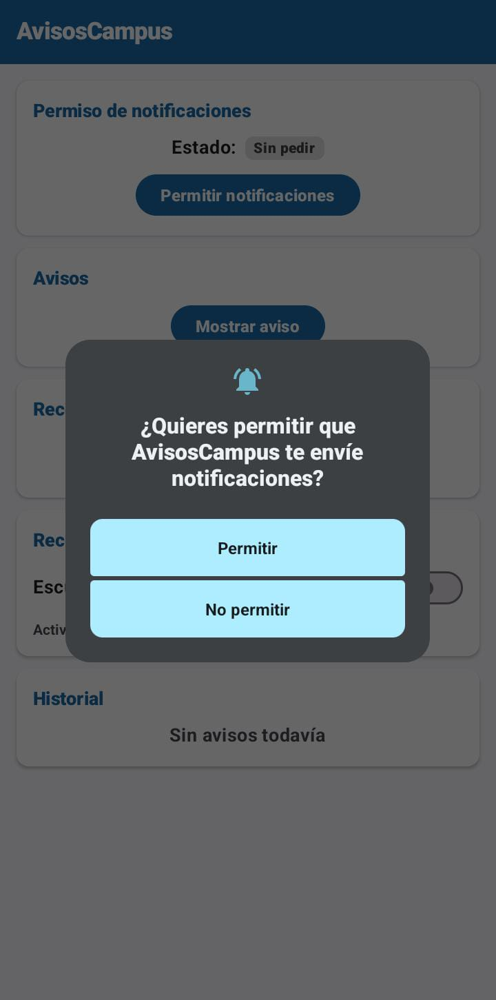
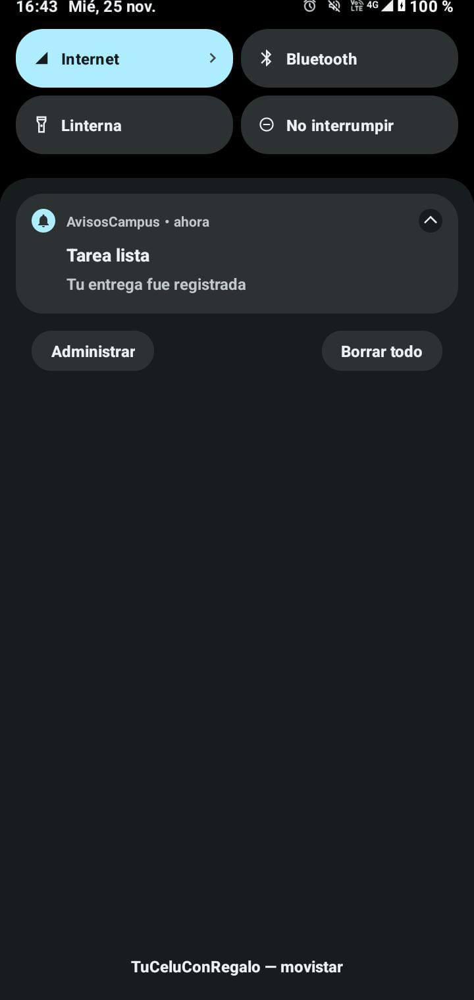
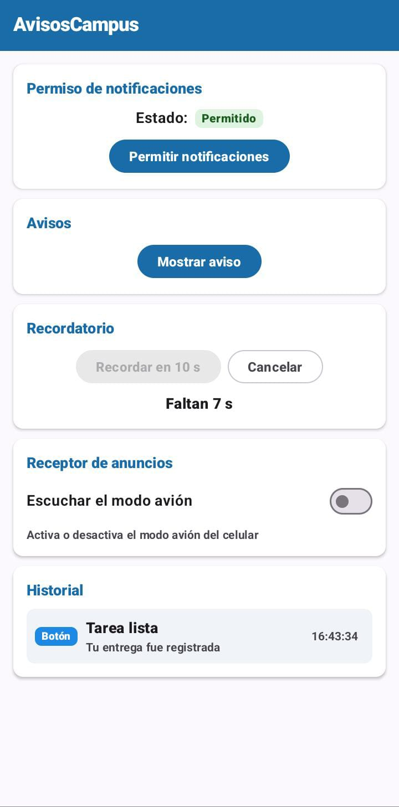
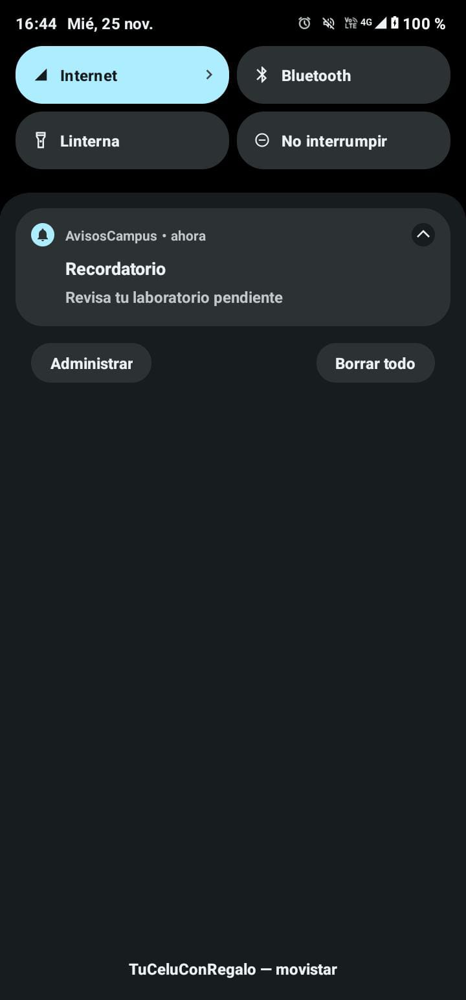
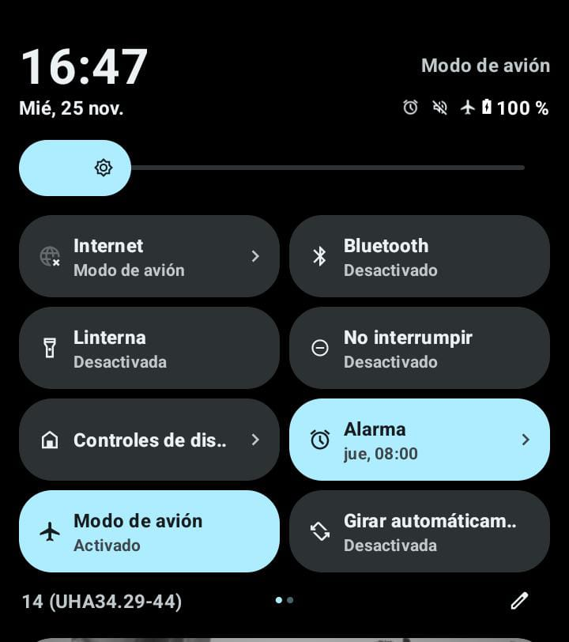
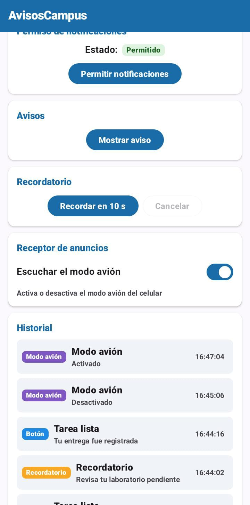
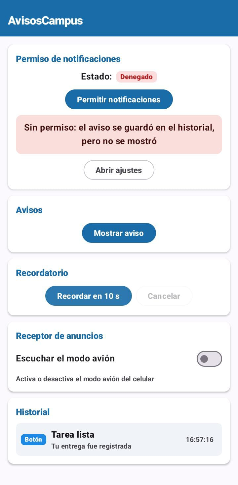

# AvisosCampus

App de Android que muestra notificaciones y escucha lo que pasa en el celular. Con un
botón muestra un aviso, con otro programa un recordatorio que llega a los 10 segundos y
puede avisar cuando se activa o desactiva el modo avión. Todo queda anotado en un
historial. Si el usuario niega el permiso, la app sigue funcionando.

| Dato | Valor |
|---|---|
| Curso | Programación en Móviles · Laboratorio 15 (Notificaciones) |
| Alumno | Karim Sovero |
| Paquete | `com.sovero.avisoscampus` |
| Tecnologías | Kotlin, Jetpack Compose + Material 3, notificaciones locales, BroadcastReceiver, corrutinas |
| Patrón | MVVM + Repository (interface) |

## Qué hace

- **Canal «Avisos»:** se crea una sola vez al iniciar la app, en `AvisosApp`.
- **Permiso:** pide `POST_NOTIFICATIONS` (Android 13+) y muestra el estado: Sin pedir,
  Permitido o Denegado.
- **Mostrar aviso:** la notificación «Tarea lista»; cada aviso tiene su propio id.
- **Tocar la notificación:** abre la app con un `PendingIntent` y la notificación se quita.
- **Recordar en 10 s:** cuenta regresiva con una corrutina; se puede cancelar.
- **Escuchar el modo avión:** con el switch activado, un `BroadcastReceiver` avisa
  «Activado» o «Desactivado».
- **Historial:** los 20 avisos más recientes, con su origen y su hora.
- **Permiso denegado:** el aviso se guarda en el historial, aparece un mensaje y el botón
  **Abrir ajustes**.

## Capturas

| Cuadro del permiso | Notificación en el panel | Recordatorio |
|---|---|---|
|  |  |  |

| Llegó el recordatorio | Modo avión activado | Historial |
|---|---|---|
|  |  |  |

| Permiso denegado |
|---|
|  |

## Estructura de paquetes

```text
com.sovero.avisoscampus/
├── AvisosApp.kt                   Application: crea el canal al iniciar
├── MainActivity.kt                crea el ViewModel con su Repository
├── model/
│   └── Modelos.kt                 Aviso, Origen, PermisoUi
├── data/
│   └── AvisosRepository.kt        interface + AvisosRepositoryMemoria (historial)
├── notificacion/
│   └── Notificador.kt             canal, permiso y mostrar la notificación
├── receiver/
│   └── ModoAvionReceiver.kt       escucha ACTION_AIRPLANE_MODE_CHANGED
├── viewmodel/
│   ├── AvisosViewModel.kt         permiso, avisos, recordatorio, modo avión y errores
│   └── AvisosViewModelFactory.kt
└── ui/
    ├── PantallaAvisos.kt          las tarjetas, el permiso y el receptor
    ├── HistorialAvisos.kt         la tarjeta Historial
    └── theme/
```

## Arquitectura MVVM

```text
View (PantallaAvisos)
   |  eventos: botones, switch              ^  collectAsState()
   v                                        |
ViewModel (AvisosViewModel) --- StateFlow (avisos, permiso, faltan...) --->
   |  registra el aviso
   |  emite: eventos (SharedFlow<Aviso>)
   v                                        v
AvisosRepository (interface)          View recibe el evento y llama a
   -> AvisosRepositoryMemoria         Notificador.mostrar(context, aviso)
```

- La **View** tiene el `Context`: pide el permiso, registra el receptor y llama al
  `Notificador`.
- El **ViewModel** decide qué avisar, lo anota en el Repository y emite un evento. No
  tiene `Context`, `NotificationManager` ni `BroadcastReceiver`.
- El **Repository** guarda el historial y no conoce la pantalla.

## Cómo ejecutarlo

1. Abrir la carpeta `Semana15` en Android Studio y hacer **Sync**.
2. Ejecutar en un celular o emulador con **Android 13 o superior**, para que aparezca el
   cuadro del permiso.
3. El modo avión se cambia desde el panel de configuración rápida del celular.

## Para pensar

**1. ¿Por qué una notificación necesita un canal y un permiso? ¿Qué pasa si falta cada uno?**
El **canal** (Android 8+) agrupa las notificaciones y deja que el usuario decida, por
tipo, si suenan o se muestran; sin canal, la notificación no aparece. El **permiso**
`POST_NOTIFICATIONS` (Android 13+) es la autorización del usuario para que la app
muestre notificaciones; sin él, `mostrar()` devuelve `false`, no sale nada y la app
muestra el mensaje con **Abrir ajustes**.

**2. ¿Por qué el ViewModel emite un evento y no muestra la notificación él mismo?**
Para mostrar una notificación se necesita un `Context`, y el ViewModel no debe tenerlo:
vive más que la pantalla y guardarlo provocaría fugas de memoria. Además, así el
ViewModel solo decide **qué** avisar y se puede probar sin Android; la pantalla, que sí
tiene `Context`, se encarga de **cómo** mostrarlo.

**3. ¿Qué pasa si usas el mismo id en dos notificaciones?**
La segunda **reemplaza** a la primera: en el panel queda una sola. Por eso cada aviso usa
su propio id (`aviso.id`), y al pulsar dos veces **Mostrar aviso** aparecen dos.

**4. ¿Por qué `onReceive` debe ser corto y por qué hay que quitar el receptor al salir?**
`onReceive` corre en el hilo principal: si hace trabajo largo, la pantalla se congela y
Android puede cerrar la app. Por eso solo lee el dato y lo entrega. Hay que quitar el
receptor (`unregisterReceiver` en `onDispose`) porque, si no, sigue escuchando aunque ya
no estés en la pantalla y se filtra memoria.

**5. ¿En qué casos usarías una notificación local y en cuáles una push de Firebase?**
**Local** cuando el aviso nace en el mismo celular: un recordatorio, una tarea terminada
o un cambio del sistema como el modo avión. **Push de Firebase** cuando el aviso viene de
un servidor o de otra persona: un mensaje nuevo, una nota publicada o un anuncio del
instituto, aunque la app esté cerrada.
